# SkyFrame

[](LICENSE)
[](https://ko-fi.com/guilhermelimait)

A black, minimal, always-on info screen for the **Waveshare ESP32-S3-Touch-LCD-4B** (the square 4″ "Smart 86 Box").
Weather, time, the sky above you, planets, the Space Station and more: 16 screens that run entirely on the board itself,
fetch their data over Wi-Fi a few times an hour, and update their own firmware from GitHub.

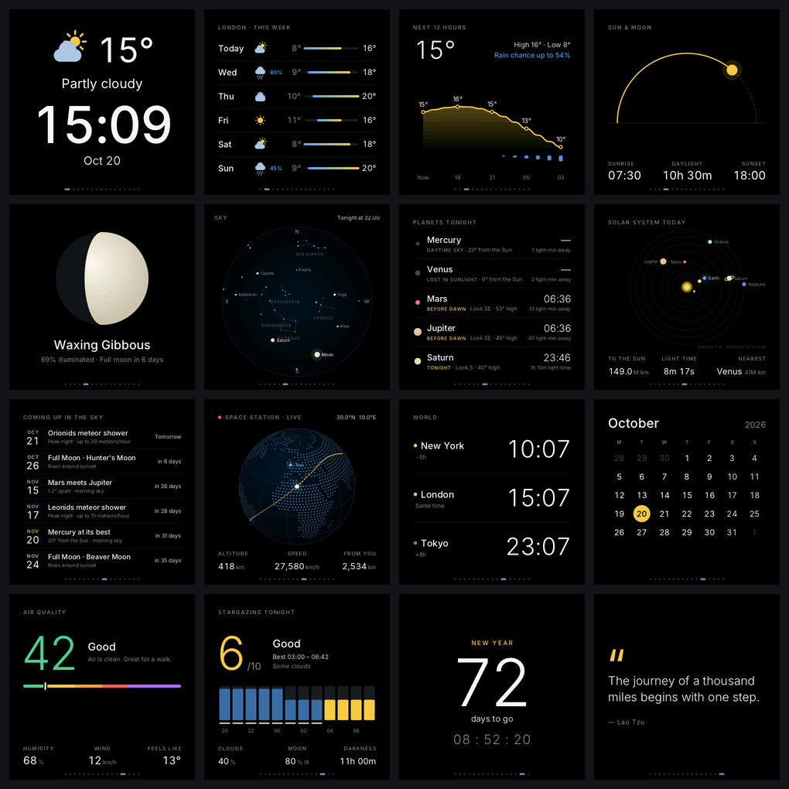

**Current version: 1.3.1** · [Changelog](CHANGELOG.md) · [Security](SECURITY.md) · [Hardware notes](docs/hardware.md)

> **Project status: proof of concept / MVP**
>
> I built this as a proof of concept: a minimum viable product showing what can be done directly on the device,
> with no PC, no cloud and no extra hardware. It's shared **as is**:
>
> - **No support is offered.** Issues and questions may not get an answer.
> - **What you see is what you get.** No roadmap, no guarantees, no promise of updates.
> - **Feel free to fork it, change it and build on it** under the [MIT license](LICENSE).

## Features

- **16 screens**, changing every 15 s with a smooth slide; drag them with your finger like pages on a phone
- **Quick settings on the display**: swipe down from the top for brightness, night mode, clock format and screen time
- **Auto-rotation**: the built-in motion sensor turns the picture to match how the display stands (or pick a fixed angle)
- **Wake on sound**: at night the screen stays at its night level and brightens for a minute when there's sound around (loudness only, nothing recorded)
- **Runs on the device**: no PC, no cloud account, no app to install
- **Light on Wi-Fi**: connects every 15 minutes to update, then switches the radio off
- **On-device astronomy**: planet positions, sky map, Moon phase and sky events are calculated offline on the chip
- **Settings in any browser** at `http://skyframe.local`, protected by a pairing code shown on the screen
- **Updates itself from GitHub**: checks every night and installs new signed versions automatically, with rollback if one misbehaves
- **Encrypted Wi-Fi password**, locked to the chip with a key nobody can read out
- **Night mode**: the backlight dims on your schedule

## Screens

| | | | |
|:-:|:-:|:-:|:-:|
| 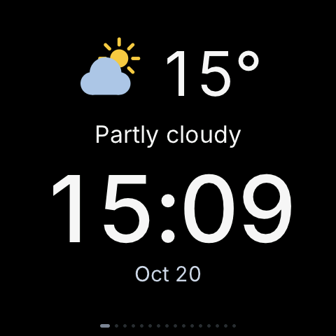<br>**Home**: weather, time, date | 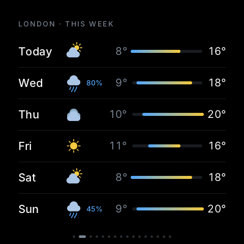<br>**Forecast**: 6 days | 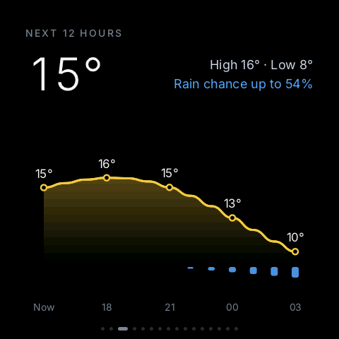<br>**Hourly**: next 12 h | 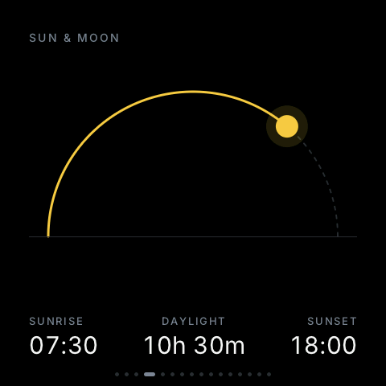<br>**Sun**: sunrise, sunset |
| 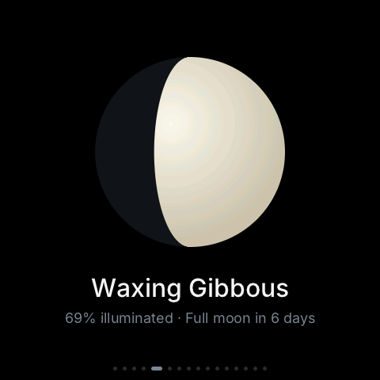<br>**Moon**: today's phase | 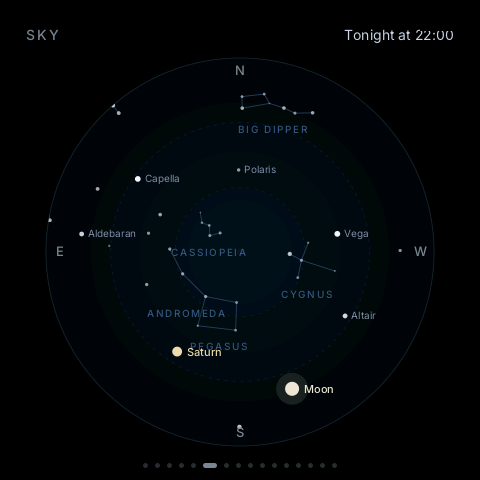<br>**Sky map**: stars & constellations | 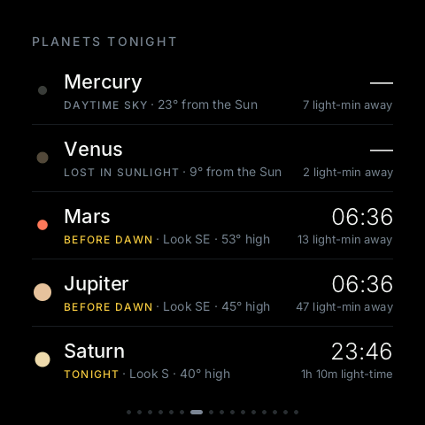<br>**Planets tonight**: when & where to look | 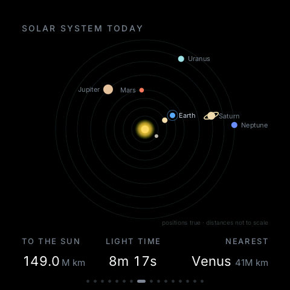<br>**Solar system**: positions today |
| 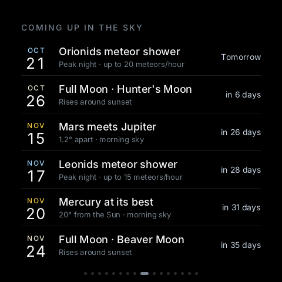<br>**Sky events**: meteors, eclipses, full moons | 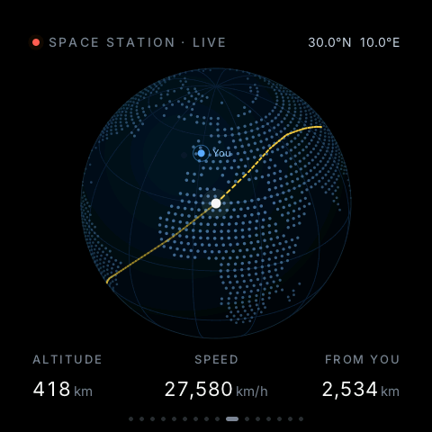<br>**Space Station**: live track | 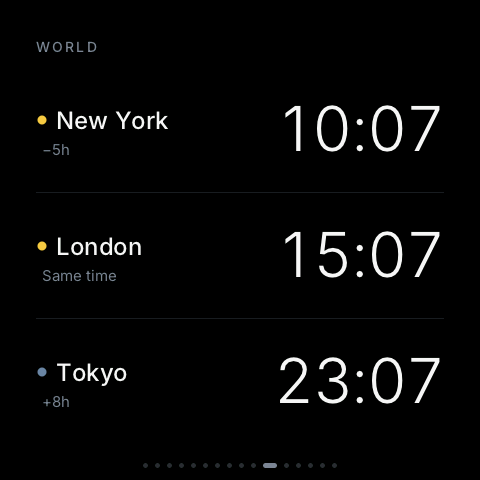<br>**World clocks**: 3 cities | 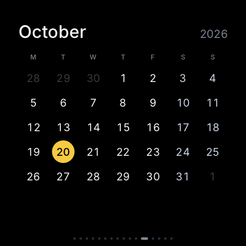<br>**Calendar**: this month |
| 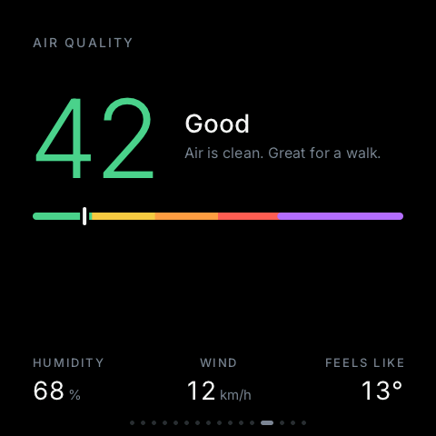<br>**Air quality**: AQI, humidity, wind | 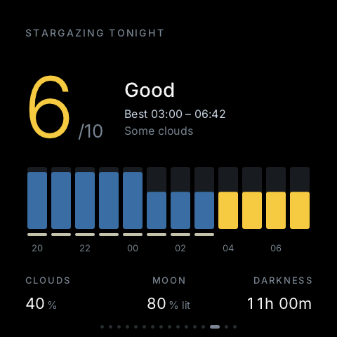<br>**Stargazing tonight**: 0–10 score, best time to look up | 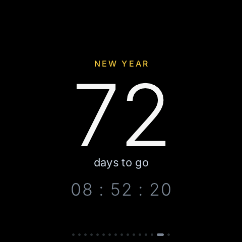<br>**Countdown**: days to an event | <br>**Quote**: one per day |

*Screenshots are taken straight from the board's frame buffer (with sample weather data).*

## Settings page

Every setting lives in a small web app served by the display itself: open `http://skyframe.local` on a phone or computer
on the same Wi-Fi. The live view on the left is drawn by the page from the display's own data, so it always shows
what's on the screen right now.

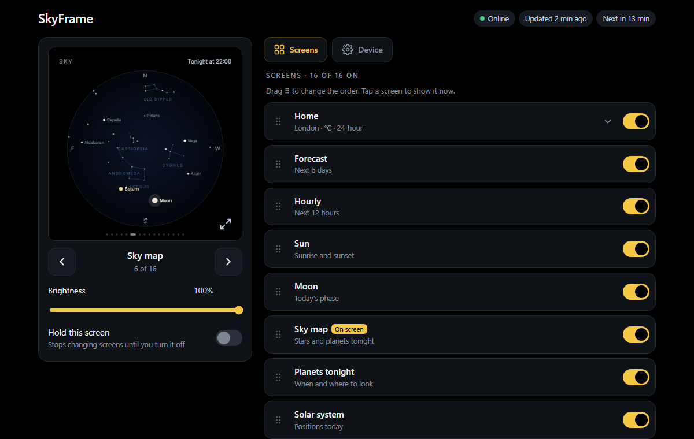

| | | |
|:-:|:-:|:-:|
| 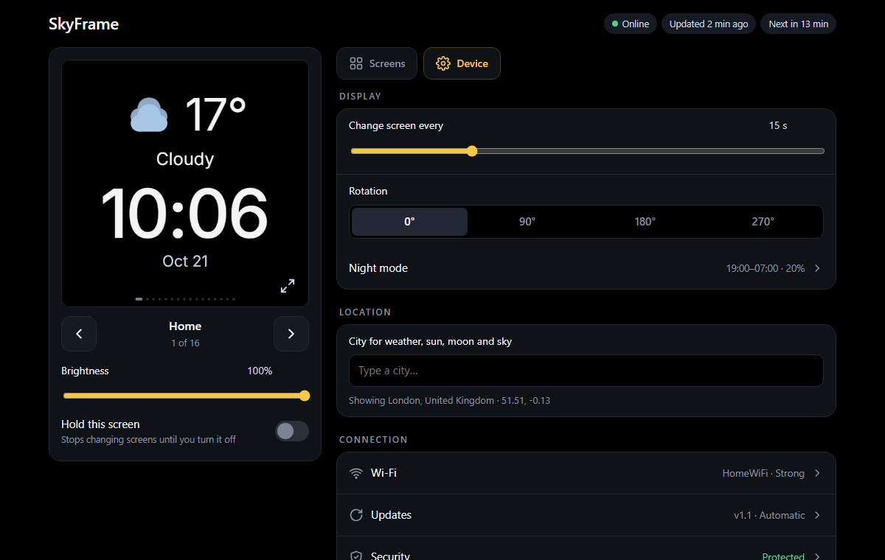<br>**Device**: interval, rotation, night mode, location, Wi-Fi, updates | 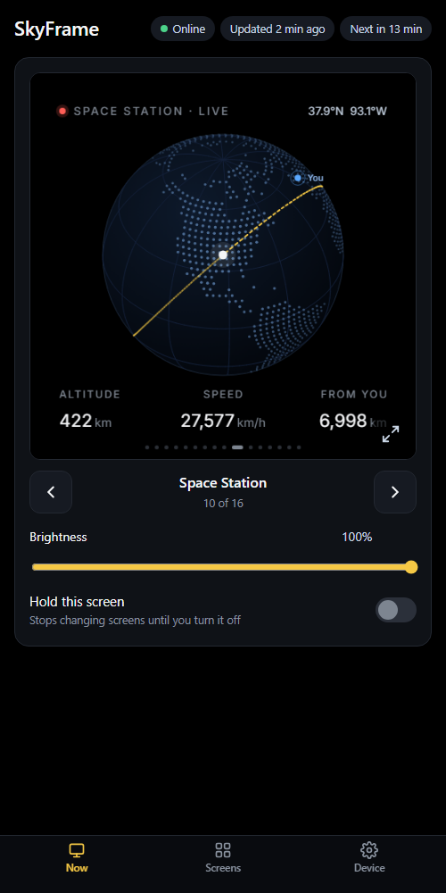<br>**On a phone**: live view and controls | 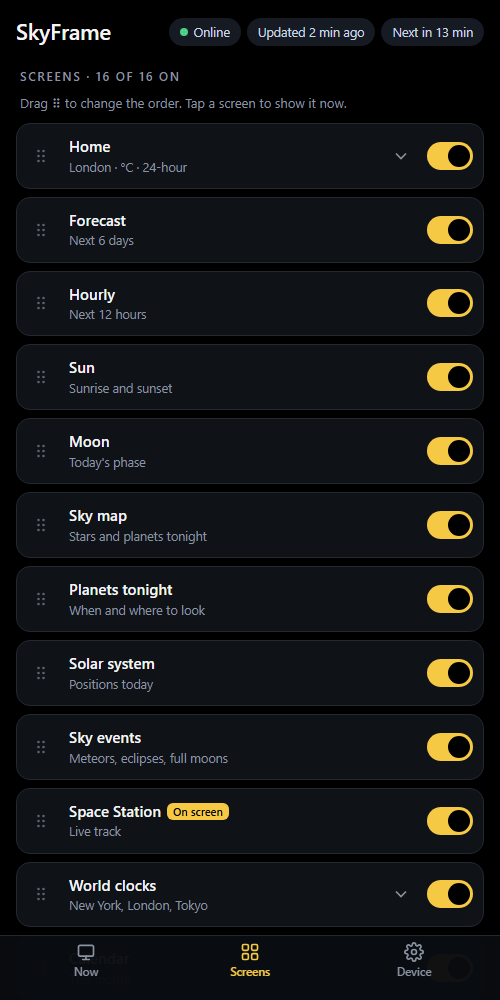<br>**Screens**: reorder, switch on or off, show now |

*Settings screenshots use sample data.*

## Hardware

| Part | Notes |
|---|---|
| [Waveshare ESP32-S3-Touch-LCD-4B](https://link.amazon/B03KjWYdE) | ESP32-S3 (16 MB flash, 8 MB PSRAM), 4″ 480×480 IPS (ST7701S), GT911 touch |
| USB-C power | Any 5 V phone charger, or the 86-box wall power option |

*The board link is an Amazon affiliate link: if you buy through it, I may earn a small commission at no extra cost to you.*

Pins, panel timing and other low-level details are in [docs/hardware.md](docs/hardware.md).

## Getting started

1. **Install [PlatformIO](https://platformio.org/)** (the VS Code extension or the command-line tools).
2. **Get the code**
   ```bash
   git clone https://github.com/guilhermelimait/SkyFrame.git
   cd SkyFrame/firmware
   ```
3. **Only if you publish your own fork:** set `OTA_REPO` in `src/app.h` to your repository and create your own update-signing key (once). This writes your public key into `src/ota_pubkey.h`
   and the private key to `skyframe-keys/`, *next to* the repository folder, never inside it:
   ```bash
   ~/.platformio/penv/Scripts/python tools/keygen.py      # Windows: %USERPROFILE%\.platformio\penv\Scripts\python.exe
   ```
   > Building the project unchanged keeps updates coming from the official SkyFrame repository.
4. **Build and flash** over USB:
   ```bash
   pio run -t upload
   ```
5. **Connect it to Wi-Fi.** The screen shows a QR code and a one-time password for the hotspot
   **SkyFrame-Setup**. Join it with your phone, pick your home network and type its password.
6. **First connection:** the chip creates its encryption key, stores your Wi-Fi password encrypted and restarts once.
   This is a one-time, permanent eFuse write; see [Security](SECURITY.md).

## Using it

| Do this | To |
|---|---|
| Drag sideways, or tap the right side | Next screen (it follows your finger and slides in) |
| Drag the other way, or tap the left third | Previous screen |
| Swipe down from the top edge | **Quick settings**: brightness, night mode, clock, screen time |
| Hold for 1 second | Turn on Wi-Fi for 10 minutes and show the settings address, a QR code and the **pairing code** |

### Quick settings

Swipe down from the top edge of any screen for five settings in rows. Tap one to open its page; on a page, swipe **left to right** to go
back to the menu (or tap ‹) and **right to left** for the next option. Swipe up on the menu to close; changes are saved
when it closes.

| | | |
|:-:|:-:|:-:|
| 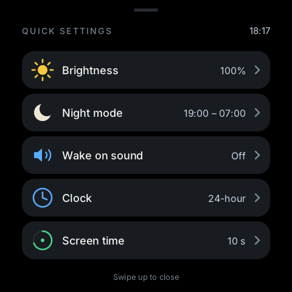<br>**Menu** | 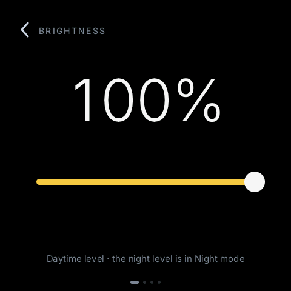<br>**Brightness**: live while you drag | 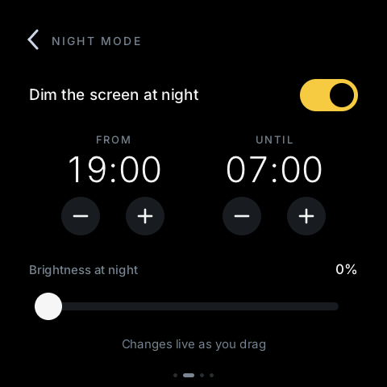<br>**Night mode**: hours and night brightness |
| 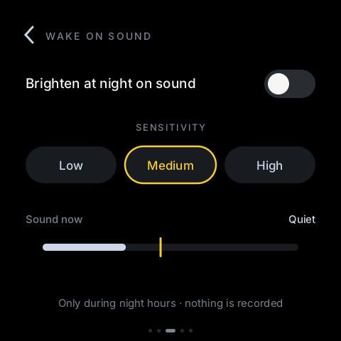<br>**Wake on sound**: sensitivity and a live meter | 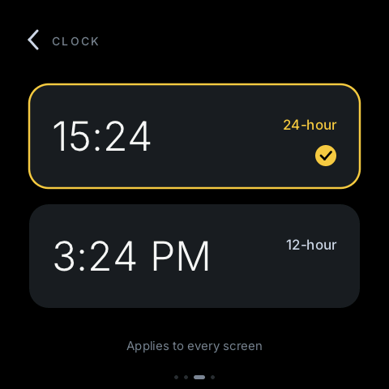<br>**Clock**: 24- or 12-hour | 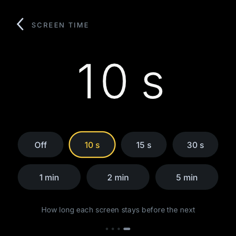<br>**Screen time**: how long each screen stays |

Open **`http://skyframe.local`** (or the IP shown) on a phone or PC on the same Wi-Fi. Scanning the QR code pairs
your phone automatically; otherwise type the 6-digit code once per browser.

The settings page works like a small app, with three tabs (on a computer, *Now* stays on the left):

| Tab | What's there |
|---|---|
| **Now** | Live view of the current screen, drawn by the page from the display's data, so it changes the moment the display does; **Show exact picture** fetches a real capture. Previous / next, brightness, and **Hold this screen** to stop rotating |
| **Screens** | All 16 screens: switch them on or off, **drag to reorder**, tap one to **show it now**. Home, World clocks and Countdown have their settings inside their card |
| **Device** | Change interval, **rotation**, night mode, location, Wi-Fi, automatic updates, security status, and *About* with GitHub, Ko-fi and the MIT license |

Changes save as you go, with a "Saved" mark and **Undo**. The first visit asks three quick questions: city,
°C/°F and 12/24-hour time.

Everything is stored on the device. Wi-Fi is normally off between updates; an open settings page keeps it on.

## Updates

SkyFrame keeps itself up to date from this repository's **[Releases](../../releases)**. Nothing to type or configure:

- **Every night between 3 and 5** the display checks GitHub. If there's a newer version, it downloads it,
  checks its signature, installs it, shows a progress screen and restarts.
- **Opening the settings page** checks GitHub (at most every 10 minutes) and shows the result at the top: the
  version and *up to date*, or a **yellow bar** when a new version is out, with **Install now** and *What's new*.
  The bar stays, with download progress, until the display is updated. Opening the page never installs anything by itself.
- The update downloads into memory first and is written to flash only after its signature checks out; the
  screen goes dark for a few seconds while it's written, then the display restarts.
- **Automatic install is on by default.** Turn it off in *Settings → Updates → Install new versions automatically*.
- **Check for updates now** in the same section checks right away; **View on GitHub** opens this page.
- Only versions **signed with the project's key** are installed, over certificate-checked HTTPS. If a new version
  can't complete an update within 10 minutes, the display **goes back to the previous one** by itself.

### Publishing a release (maintainers)

1. Raise `FW_VERSION` in `firmware/src/app.h` (for example `1.2`) and add an entry to [CHANGELOG.md](CHANGELOG.md).
2. Build and sign it:
   ```bash
   cd firmware
   ~/.platformio/penv/Scripts/python tools/release.py
   ```
   This creates `release/firmware.bin` and `release/firmware.sig`.
3. On GitHub: **Releases → Draft a new release**, tag **`v1.2`**, attach both files, **Publish**.
   Displays pick it up the same night.

> ⚠️ The private key (`skyframe-keys/ota_signing_key.pem`, outside the repository) must stay private and backed up.
> Without it no update can be published that displays will accept.

### Your own fork

Set `OTA_REPO` in `firmware/src/app.h` to your repository, run `tools/keygen.py` to create your own key, and flash
once over USB. From then on your display follows your releases.

## Security

| | |
|---|---|
| Settings page | 6-digit pairing code shown on the device; 5 wrong tries lock it for a minute |
| First-time setup hotspot | WPA2, with a fresh random password shown on the screen |
| Stored Wi-Fi password | AES-256-GCM, key derived from a read-protected eFuse key that only the chip's HMAC hardware can use |
| Internet connections | HTTPS with certificate checks (Mozilla root bundle built into ESP-IDF) |
| Firmware updates | ECDSA P-256 signatures, version check, automatic rollback |
| Data sent out | Only coordinates for your city and world clocks (to Open-Meteo): no accounts, no tracking. The settings page loads nothing from the internet except city searches |

**Tip:** put the display on a guest or IoT Wi-Fi network. Details, limits and how to report a problem: [SECURITY.md](SECURITY.md).

## Troubleshooting

| Problem | Fix |
|---|---|
| Settings page doesn't open | Wi-Fi is off between updates: hold the screen for 1 second, then try again |
| `skyframe.local` doesn't work (some Android phones) | Use the IP address shown when you hold the screen |
| Asked for a pairing code | Hold the screen for 1 second to see it, or scan the QR code |
| "offline" in the top corner | No successful update for over an hour: check the Wi-Fi or router |
| Moved house / new router | Settings → Wi-Fi → *Change Wi-Fi network*, then set it up again from the screen |
| An update went wrong | Nothing to do: the display goes back to the previous version by itself |

## Project structure

```
skyframe/
├── firmware/                 PlatformIO project for the board
│   ├── src/
│   │   ├── main.cpp          screen loop, touch gestures, sliding transitions, USB debug commands
│   │   ├── quick.cpp         quick-settings panel (swipe down from the top)
│   │   ├── mic.cpp           room loudness from the microphone (wake on sound)
│   │   ├── es7210.cpp        audio chip driver (Espressif, MIT)
│   │   ├── screens.cpp       the 16 screens (+ setup, settings-info and update screens)
│   │   ├── gfx.cpp           anti-aliased 2D drawing + TrueType text
│   │   ├── hw.cpp            ST7701S panel, backlight, GT911 touch
│   │   ├── net.cpp           Wi-Fi schedule, settings storage, weather / air / ISS data
│   │   ├── web.cpp           settings web app (pairing code) and Wi-Fi setup portal
│   │   ├── web_pages.h       the settings and setup pages
│   │   ├── ota.cpp           signed updates from GitHub Releases
│   │   ├── secure_store.cpp  chip-bound encryption of the Wi-Fi password
│   │   ├── astro.cpp         planets, Moon, stars, sky events
│   │   └── ota_pubkey.h      public key that updates must be signed with
│   ├── data/                 Inter font (+ its license)
│   └── tools/                keygen.py, release.py, shot.py, make_land.py
├── web/skyframe.html         the original browser version of the design
├── docs/                     screenshots (screens and settings page) and hardware notes
├── CHANGELOG.md
└── SECURITY.md
```

## Development

With the board on USB, `tools/shot.py` (needs the `pyserial` and `Pillow` Python packages) talks to a small debug channel to take real screenshots:

```bash
python tools/shot.py out t=now demo s=0 shot s=1 shot
```

| USB command | Effect |
|---|---|
| `dump` | send the current frame (480×480 RGB565) |
| `t <unix time>` | set the clock (to test without Wi-Fi) |
| `demo` | load sample weather, air-quality and Space Station data |
| `s <n>` | force screen *n* (`-1` releases it) |
| `log` | toggle event logging (touches, screen changes, draw times) |
| `update` | check GitHub now and install a newer version, with the log over USB |
| `radio 0` / `radio 1` | force Wi-Fi off / back on (to check whether a glitch comes from network activity) |
| `mic on` / `mic off` / `mic` | start or stop the microphone, print its loudness (both channels, dBFS) |
| `i2c` | list the chips on the sensor bus (touch, motion sensor, audio, RTC, power) |
| `imu` | print the motion sensor's gravity reading and the current rotation |
| `quick <n>` | open the quick-settings panel on page *n* (`-1` menu, `0`–`3` pages), e.g. for screenshots |
| `resync` | restart the panel's picture output at the next frame (prints `RESYNC 0` when accepted) |
| `sigtest <hex signature> <message>` | check a signature with the built-in update key |

The debug channel only works over a USB cable and can't read the Wi-Fi password. It can capture whatever
the screen shows, including the pairing-code screen, the same as someone holding the board.

### Testing updates

To try the whole update path without publishing anything, flash the **update-test** build. It is the normal
firmware, but it reports version 1.0.9 (use it from 1.2 on: 1.1 can't download updates):

```bash
pio run -e update-test -t upload
```

Open the settings page: the display finds the latest release on GitHub, shows the yellow **update available** bar,
and **Install now** downloads it, checks its signature, installs it and restarts on the real release.

### Browser version

`web/skyframe.html` is the original design as a single web page: open it in any browser
(`?city=Lisbon&units=f&h12=1&rotate=20` to customise). It also has a NASA picture-of-the-day screen and the original focus timer.

## Support

SkyFrame is free and open source. If you enjoy it, you can support it on Ko-fi:

[](https://ko-fi.com/guilhermelimait)

The display's settings page has the same link under *About*.

## Credits

- Weather and air-quality data: [Open-Meteo](https://open-meteo.com/) (CC BY 4.0)
- Space Station positions: [wheretheiss.at](https://wheretheiss.at/)
- Planet positions: JPL *Approximate Positions of the Planets* (E. M. Standish); seasons from Meeus, *Astronomical Algorithms*
- World map: [world-atlas](https://github.com/topojson/world-atlas) (ISC), from [Natural Earth](https://www.naturalearthdata.com/) (public domain)
- Font: [Inter](https://rsms.me/inter/) by Rasmus Andersson (SIL Open Font License 1.1)
- Text rendering: [stb_truetype](https://github.com/nothings/stb) by Sean Barrett (public domain / MIT)
- Libraries: [ArduinoJson](https://arduinojson.org/) (MIT), [QRCode](https://github.com/ricmoo/QRCode) (MIT), [Arduino-ESP32](https://github.com/espressif/arduino-esp32) & ESP-IDF (Apache 2.0)
- Display setup values: Waveshare's official examples for this board

## License

MIT, see [LICENSE](LICENSE). You're free to use, copy, modify and redistribute this project, including
commercially, as long as the copyright and license notice stay with it. Third-party parts (font, map data, libraries) keep their own licenses: see [THIRD_PARTY_NOTICES.md](THIRD_PARTY_NOTICES.md). It comes with no warranty and no support:
see *Project status* at the top.
